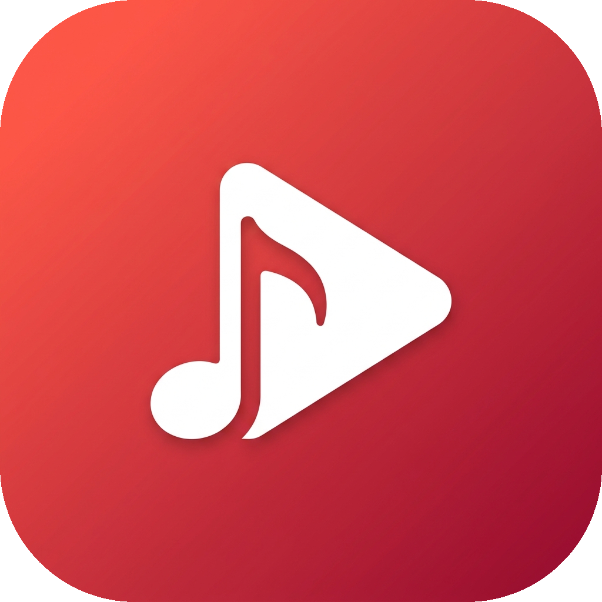

<div align="center">
  
  <h1>Playmio</h1>
  <p><strong>A desktop music player built around your own library.</strong></p>
  <p>
    Play local audio files from watched folders, find and save albums through your own
    <strong>Prowlarr</strong> or <strong>Jackett</strong> torrent indexer, or stream from
    <strong>YouTube</strong> — no account, no subscription, and no built-in catalog.
  </p>
  <p>
    <a href="#features">Features</a> ·
    <a href="#installation">Installation</a> ·
    <a href="#tech-stack">Tech Stack</a> ·
    <a href="#running-from-source">Running from Source</a> ·
    <a href="#roadmap">Roadmap</a> ·
    <a href="#documentation">Documentation</a>
  </p>
  <p>
    <strong>English</strong> · <a href="README.pt-BR.md">Português (Brasil)</a>
  </p>
</div>

---

> [!NOTE]
> Personal project in early development (0.x versions). It works, but it still changes a lot.

## Features

The library starts empty and holds only what you explicitly add.

- **Local library & watched folders:** import individual files or whole folders (**MP3, FLAC, WAV, OGG, Opus, M4A, AAC, and WebM**). Added folders are watched automatically so new, changed, and removed files stay in sync.
- **Tags, covers & browsing:** embedded metadata and cover art are read on import and cached locally. Browse by **Library**, **Albums**, **Folders**, **Favorites**, and **Recents**, in list or grid view, with filters by artist, genre, format, and origin.
- **Torrents via your own indexer:** **Discover** searches your configured **Prowlarr** or **Jackett** (Torznab) instance, streams any track right away, and lets you save the albums or tracks you want to keep into your library.
- **YouTube videos, playlists & livestreams:** paste links to stream audio resolved on demand through `yt-dlp`. Livestreams play via `ffmpeg` and reconnect automatically if dropped.
- **Playlists & queue:** build playlists from selected tracks, reorder them, import and export UTF-8 **M3U/M3U8** files, and save the active queue as a playlist.
- **Non-destructive by design:** imported audio files are never moved, edited, or deleted. Album and tag edits live in the app only and can be reverted anytime.
- **Local-first, no telemetry:** your library, playlists, and preferences live in a local JSON file. Network requests happen only for YouTube and for the indexer and torrents you configure.

---

## Installation

Download the latest installer from the [Releases](https://github.com/gustmrg/playmio/releases) page (each release includes a `SHA256SUMS.txt` file for verification):

| Platform | Package | Architecture |
| --- | --- | --- |
| **macOS** | `.dmg` | Apple Silicon (`arm64`), macOS 13+ |
| **Windows** | `.exe` (NSIS) | `x64` |
| **Linux** | `.AppImage` / `.deb` | `x64` |

### Optional dependencies

The local library and player work out of the box. External tools are only needed for network features:

- **YouTube:** requires an up-to-date [yt-dlp](https://github.com/yt-dlp/yt-dlp) on your `PATH` ([how to update](docs/installation.md#keep-yt-dlp-up-to-date)). Livestreams also require [ffmpeg](https://ffmpeg.org) on your `PATH`.
- **Discover:** requires your own **Prowlarr** or **Jackett** (Torznab) instance running separately, configured in **Settings → Indexer** ([setup guide](docs/installation.md#indexer-discover)).

> [!IMPORTANT]
> The installers are **not signed**. macOS and Windows show a warning the first time you open the app; see how to allow it in [Installation](docs/installation.md#unsigned-app).

> [!WARNING]
> Torrent streams download **and upload** pieces of files to other peers, who can see your IP address. Whether this is legal depends on your country and on the content. You are responsible for what you search, play, and save.

---

## Tech Stack

| Layer | Technology |
| --- | --- |
| **Desktop runtime** | Electron 45 (TypeScript main process & sandboxed preload bundled with esbuild) |
| **Interface** | React 19, Vite, TypeScript, Tailwind CSS v4, Base UI, Lucide |
| **Audio & metadata** | `HTMLAudioElement`, custom `playmio://` protocol (byte-range streaming), `music-metadata` |
| **Integrations** | `webtorrent`, Prowlarr / Torznab XML API, `yt-dlp`, `ffmpeg` |

---

## Running from Source

Requires **Node.js 22.18+** and **npm** (CI pins Node.js 24.22.1 to match Electron's bundled runtime).

```bash
npm install
npm run dev
```

| Command | Description |
| --- | --- |
| `npm run dev` | Start Vite and Electron with main-process rebuilds and restarts |
| `npm run dev:web` | Start the limited browser preview at `http://127.0.0.1:5173` |
| `npm run typecheck` | Type-check renderer, main process, preload, and the IPC contract |
| `npm test` | Run main-process tests (`electron/*.test.ts`) directly with Node |
| `npm run build` | Build renderer (`dist/`) and Electron bundles (`dist-electron/`) |
| `npm run dist` | Package platform installers into `release/` |

See [Development](docs/development.md) for the project layout and security model.

---

## Roadmap

- [ ] Save the audio of YouTube tracks and livestreams into the library.

---

## Documentation

- [Installation](docs/installation.md) — downloads, unsigned app warnings, updates, YouTube, and indexer setup
- [Usage](docs/usage.md) — library, albums, playlists, Discover, YouTube, and current limits
- [Development](docs/development.md) — scripts, project layout, and security model
- [Releases](docs/releasing.md) — how versions are tagged and published
- [Architecture Decisions](docs/adr/README.md) — architecture decision records (ADRs)

The detailed documentation is in English. Only the README is also available in Portuguese.

---

## License

[MIT](LICENSE)
