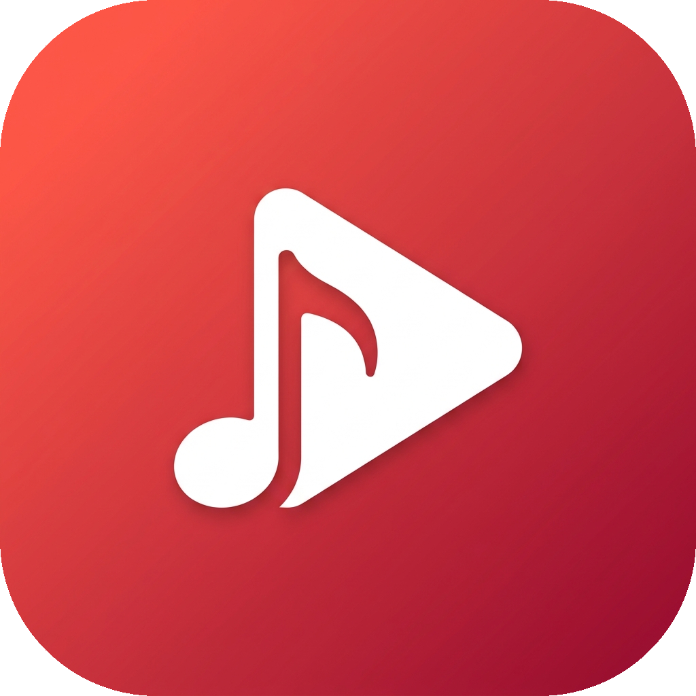

<div align="center">
  
  <h1>Playmio</h1>
  <p><strong>Um player de música para desktop construído em torno da sua própria biblioteca.</strong></p>
  <p>
    Ouça arquivos de áudio locais em pastas monitoradas, encontre e salve álbuns pelo seu próprio
    indexador de torrents <strong>Prowlarr</strong> ou <strong>Jackett</strong>, ou faça streaming do
    <strong>YouTube</strong> — sem conta, sem assinatura e sem catálogo embutido.
  </p>
  <p>
    <a href="#recursos">Recursos</a> ·
    <a href="#instalação">Instalação</a> ·
    <a href="#tecnologias">Tecnologias</a> ·
    <a href="#rodando-a-partir-do-código">Rodando a partir do código</a> ·
    <a href="#próximos-passos">Próximos passos</a> ·
    <a href="#documentação">Documentação</a>
  </p>
  <p>
    <a href="README.md">English</a> · <strong>Português (Brasil)</strong>
  </p>
</div>

---

> [!NOTE]
> Projeto pessoal em desenvolvimento inicial (versões 0.x). Funciona, mas ainda muda bastante.

## Recursos

A biblioteca começa vazia e só tem o que você adicionar explicitamente.

- **Biblioteca local e pastas monitoradas:** importe arquivos avulsos ou pastas inteiras (**MP3, FLAC, WAV, OGG, Opus, M4A, AAC e WebM**). As pastas adicionadas são monitoradas automaticamente, mantendo arquivos novos, alterados e removidos sempre sincronizados.
- **Tags, capas e navegação:** metadados e capas embutidas são lidos na importação e mantidos em cache local. Navegue por **Biblioteca**, **Álbuns**, **Pastas**, **Favoritos** e **Recentes**, em lista ou grade, com filtros por artista, gênero, formato e origem.
- **Torrents pelo seu indexador:** o **Descobrir** busca na sua instância do **Prowlarr** ou **Jackett** (Torznab), toca qualquer faixa na hora por streaming e permite salvar na biblioteca os álbuns ou faixas que você quiser manter.
- **Vídeos, playlists e lives do YouTube:** cole links para ouvir por streaming resolvido sob demanda pelo `yt-dlp`. Transmissões ao vivo tocam via `ffmpeg` e reconectam sozinhas em caso de queda.
- **Playlists e fila:** crie playlists a partir de faixas selecionadas, reordene, importe e exporte arquivos **M3U/M3U8** em UTF-8 e salve a fila atual como playlist.
- **Seus arquivos intactos:** os arquivos de áudio importados nunca são movidos, editados nem excluídos. Edições de álbum e tags ficam apenas no aplicativo e podem ser revertidas a qualquer momento.
- **Local-first e sem telemetria:** sua biblioteca, playlists e preferências ficam em um arquivo JSON local. O acesso à rede acontece apenas para o YouTube e para o indexador e os torrents que você configurar.

---

## Instalação

Baixe o instalador mais recente na página de [Releases](https://github.com/gustmrg/playmio/releases) (cada release inclui um arquivo `SHA256SUMS.txt` para verificação):

| Plataforma | Pacote | Arquitetura |
| --- | --- | --- |
| **macOS** | `.dmg` | Apple Silicon (`arm64`), macOS 13+ |
| **Windows** | `.exe` (NSIS) | `x64` |
| **Linux** | `.AppImage` / `.deb` | `x64` |

### Dependências opcionais

A biblioteca local e o player funcionam sem nada extra. Ferramentas externas são necessárias apenas para recursos de rede:

- **YouTube:** exige o [yt-dlp](https://github.com/yt-dlp/yt-dlp) atualizado no `PATH` ([como atualizar](docs/installation.md#keep-yt-dlp-up-to-date)). Transmissões ao vivo também exigem o [ffmpeg](https://ffmpeg.org) no `PATH`.
- **Descobrir:** exige sua própria instância do **Prowlarr** ou **Jackett** (Torznab) rodando separadamente, configurada em **Configurações → Indexador** ([guia de configuração](docs/installation.md#indexer-discover)).

> [!IMPORTANT]
> Os instaladores **não são assinados**. macOS e Windows mostram um aviso na primeira abertura; veja como liberar o aplicativo em [Installation](docs/installation.md#unsigned-app).

> [!WARNING]
> Streams por torrent baixam **e enviam** partes dos arquivos para outras pessoas da rede, que veem o seu IP. A legalidade depende do país e do conteúdo. Você é responsável pelo que busca, toca e salva.

---

## Tecnologias

| Camada | Tecnologia |
| --- | --- |
| **Runtime desktop** | Electron 45 (processo principal em TypeScript e preload em sandbox empacotados com esbuild) |
| **Interface** | React 19, Vite, TypeScript, Tailwind CSS v4, Base UI, Lucide |
| **Áudio e metadados** | `HTMLAudioElement`, protocolo próprio `playmio://` (streaming com byte-range), `music-metadata` |
| **Integrações** | `webtorrent`, API XML Prowlarr / Torznab, `yt-dlp`, `ffmpeg` |

---

## Rodando a partir do código

Requer **Node.js 22.18+** e **npm** (o CI fixa o Node.js 24.22.1, a mesma versão embutida no Electron).

```bash
npm install
npm run dev
```

| Comando | Descrição |
| --- | --- |
| `npm run dev` | Inicia Vite e Electron com rebuild e reinício automático do processo principal |
| `npm run dev:web` | Inicia a prévia limitada no navegador em `http://127.0.0.1:5173` |
| `npm run typecheck` | Verifica tipos do renderer, processo principal, preload e contrato IPC |
| `npm test` | Executa os testes do processo principal (`electron/*.test.ts`) diretamente no Node |
| `npm run build` | Compila a interface (`dist/`) e os bundles do Electron (`dist-electron/`) |
| `npm run dist` | Gera os instaladores das plataformas em `release/` |

Veja [Development](docs/development.md) para a estrutura do projeto e o modelo de segurança.

---

## Próximos passos

- [ ] Salvar na biblioteca o áudio de faixas e livestreams do YouTube.

---

## Documentação

- [Installation](docs/installation.md) — downloads, avisos de app sem assinatura, atualizações, YouTube e configuração de indexadores
- [Usage](docs/usage.md) — biblioteca, álbuns, playlists, Descobrir, YouTube e limites atuais
- [Development](docs/development.md) — scripts, estrutura do projeto e modelo de segurança
- [Releases](docs/releasing.md) — como versões são marcadas e publicadas
- [Architecture Decisions](docs/adr/README.md) — registros de decisões de arquitetura (ADRs)

A documentação detalhada está em inglês. Apenas o README também está disponível em português.

---

## Licença

[MIT](LICENSE)
